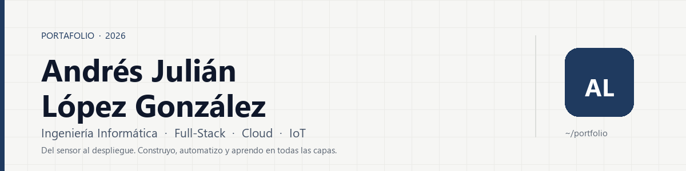

<picture>
  <source media="(prefers-color-scheme: dark)" srcset="https://raw.githubusercontent.com/andres-lopez-g/andres-lopez-g/main/assets/banner-dark.png">
  <source media="(prefers-color-scheme: light)" srcset="https://raw.githubusercontent.com/andres-lopez-g/andres-lopez-g/main/assets/banner-light.png">
  
</picture>

---

Estudiante de **Ingeniería Informática** (8.º semestre) en el Politécnico Colombiano
"Jaime Isaza Cadavid". He gestionado el área de TI de una empresa de proyectos eléctricos
y electrónicos y trabajé en soporte técnico bilingüe en Amazon. Hoy mi foco es **cloud**:
serverless, contenedores y Terraform.

🔭 **Construyendo** CVFit · 🌱 **Aprendiendo** Terraform y Bedrock · 🤝 **Abierto a** prácticas y roles junior

## 🚀 Proyectos

| Proyecto | Qué hace | Stack |
|:---|:---|:---|
| [**CVFit**](https://github.com/andres-lopez-g/cvfit) | Adapta tu CV a una oferta: score de match, keywords faltantes y tip de entrevista. 100 % serverless. | AWS · Lambda · Bedrock · Terraform |
| [**comp-nube**](https://github.com/andres-lopez-g/comp-nube) | Miniaturas serverless: S3 → Lambda → ECS Fargate → S3, con contenedor efímero. | AWS · ECS · Docker · Terraform |
| [**CarScan**](https://github.com/andres-lopez-g/CarScan) | Buscador de vehículos con scrapers, PostGIS y mapa interactivo. | FastAPI · Next.js · PostGIS |
| [**AsisT**](https://github.com/andres-lopez-g/AsisT) | Asistente personal full-stack: finanzas, archivos y planner Kanban. | React · Node.js · PostgreSQL |
| [**huffman-compression**](https://github.com/andres-lopez-g/huffman-compression) | Compresor de archivos con Huffman desde cero en C++17. | C++17 |
| [**esp32-meteorologia**](https://github.com/andres-lopez-g/esp32-meteorologia) | Estación meteorológica con ESP32 y ThingSpeak. | ESP32 · MicroPython · IoT |

También: [ml-face-censor](https://github.com/andres-lopez-g/ml-face-censor) ·
[API-gobierno](https://github.com/andres-lopez-g/API-gobierno) ·
[final-bdd2](https://github.com/andres-lopez-g/final-bdd2) ·
[torredebabel](https://github.com/andres-lopez-g/torredebabel)

## 🧰 Stack

También: Neo4j · MicroPython · ESP32 · ThingSpeak · PostGIS

## 🎓 Formación y certificaciones

- **Ingeniería Informática** — Politécnico Colombiano "Jaime Isaza Cadavid" · 8.º semestre
- Linux Essentials (Cisco) · MongoDB for SQL Professionals · Data Fundamentals (IBM) · Registered Scrum Basics™ · Iniciación al desarrollo con IA (BIG school)

## 📈 Actividad

## 📫 Hablemos

Abierto a **prácticas, proyectos freelance y roles junior** en cloud, backend, datos, IoT o ML.

[Email](mailto:andresjlopezgo@hotmail.com) · [LinkedIn](https://www.linkedin.com/in/andr%C3%A9s-juli%C3%A1n-l%C3%B3pez-gonz%C3%A1lez-101366392) · [Portafolio](https://andres-lopez-g.github.io)

English B2+ · Open to internships and junior roles in cloud, backend, data, IoT or ML.
